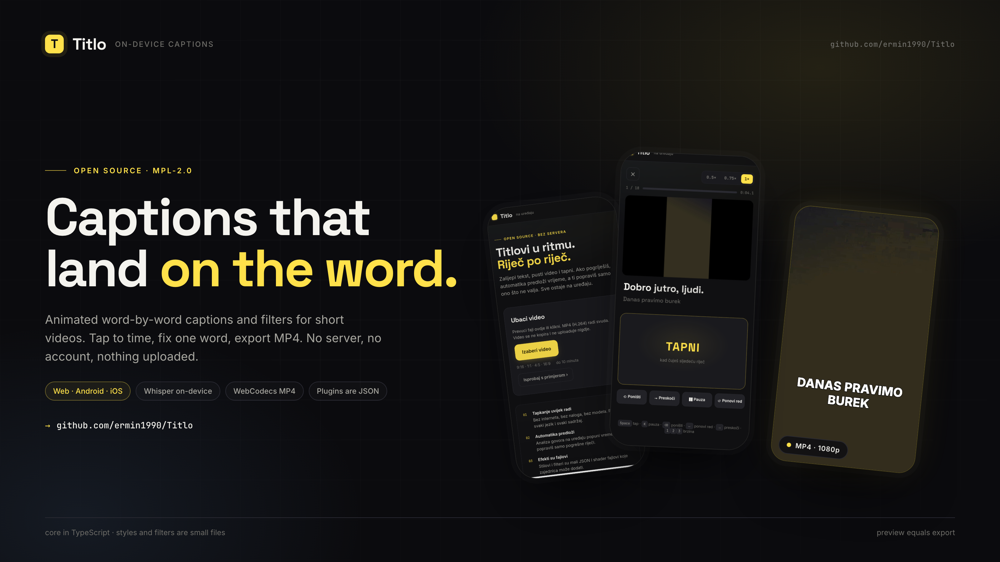
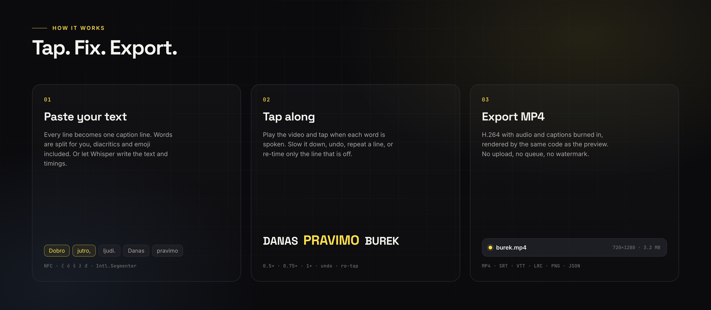
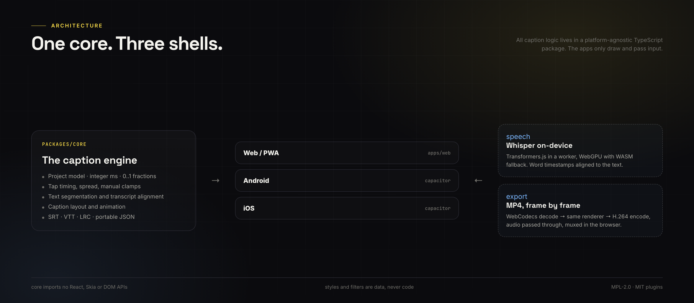

# Titlo

[](https://github.com/ermin1990/Titlo/actions/workflows/ci.yml)
[](LICENSE)
[](#mobile)

On-device animated word-by-word captions and filters for short videos.

Paste your text, tap along with the video, fix a word if it is wrong, and export an MP4 with the
captions burned in. Speech recognition is optional and runs locally. **No server, no account, no
upload.**



> Status: working prototype. The web app, the word-by-word editor, the plugin styles, speech
> recognition and MP4 export are implemented. The Android and iOS shells build; real-device testing
> and a release build are still ahead.

---

## Table of contents

- [Why](#why)
- [Features](#features)
- [Quick start](#quick-start)
- [Mobile](#mobile)
- [How it works](#how-it-works)
- [Editing](#editing)
- [Project structure](#project-structure)
- [Design rules](#design-rules)
- [Testing](#testing)
- [Roadmap](#roadmap)
- [Contributing](#contributing)
- [Privacy](#privacy)
- [License](#license)

## Why

Good animated-caption tools are paid, upload your video to a server, and handle smaller languages
poorly. Automatic recognition fails on names, slang and singing, and fixing it on a phone is slow.

Titlo is built around three timing methods that complement each other:

1. **Tap.** The text is already there; you tap when each word is spoken. Works for every language
   and every kind of content.
2. **Auto-time.** On-device audio analysis distributes words over the detected speech. A quick first
   pass that you correct only where needed.
3. **Speech recognition.** Whisper writes the text and word timings on the device. You fix the
   mistakes.

## Features

### Captions

- Word-by-word highlighting with six built-in styles and per-style animation presets.
- Animations: fade, pop, slide from top/bottom, scale, typewriter, blur, wiggle.
- Caption box: drag it directly on the preview, or set X, Y and width in the style panel.
- Safe zones for Instagram, TikTok and YouTube Shorts.
- Bilingual-ready text handling: NFC normalization, `č ć š ž đ`, Cyrillic, emoji, no-space
  languages via `Intl.Segmenter`.
- SRT, VTT and LRC import/export; PNG frame export; portable `.titlo.json` project files.

### Timing

- Tap mode: 0.5× / 0.75× / 1×, undo, skip, repeat line, haptics.
  Keyboard: `Space`, `K`, `⌫`, `←`, `→`, `1` `2` `3`.
- One-line re-tap: correct only the line that is off.
- Per-word start/end sliders with 10 ms steps; edges stop at the neighbouring word.
- Global offset for Bluetooth latency.
- Every word remembers where its time came from: `tap`, `auto`, `aligned`, `spread` or `manual`,
  and the editor colours it accordingly.

### Speech recognition

- Whisper through Transformers.js, running in a Web Worker on WebGPU (WASM fallback).
- Three model sizes: tiny (~40 MB), base (~80–150 MB), small (~250–500 MB).
- Word-level timestamps aligned to the recognised text, so a trailing letter can never jump into
  the next word.
- Language picker (`bs`, `hr`, `sr`, `en`, auto-detect).
  > Tip: for Bosnian, Croatian often transcribes better, because the model has more training data
  > for it. Try both on the same clip.

### Export

- **MP4, H.264 + AAC**, captions and filter burned in, rendered by the same renderer as the preview.
- Audio is passed through without re-encoding.
- Video is decoded frame by frame (`VideoDecoder`), rendered on an `OffscreenCanvas`, encoded with
  `VideoEncoder` and muxed with `mp4-muxer`.
- The finished file is saved or shared through the system share sheet on mobile.
- Limits: 5 minutes per export, 1080p maximum output.

## Quick start

```bash
pnpm install
pnpm dev
# open http://127.0.0.1:5173
```

No video at hand? Click **Isprobaj s primjerom** on the start screen.

```bash
pnpm test        # core tests (Vitest)
pnpm typecheck   # TypeScript across all packages
pnpm build       # production web build + PWA
```

Requirements: Node 22+, pnpm 9+. No API keys, no backend.

## Mobile

The same web app is packaged with [Capacitor](https://capacitorjs.com) for Android and iOS. There is
no second implementation and no second renderer.

```bash
pnpm build
npx cap sync
npx cap open android   # or: npx cap open ios
```

Android CLI build (debug APK):

```bash
cd android
JAVA_HOME=/usr/local/opt/openjdk@21 ./gradlew assembleDebug
# android/app/build/outputs/apk/debug/app-debug.apk
```

JDK 21 is required; Java 25 is rejected by the current Gradle/AGP toolchain.

iOS simulator build:

```bash
xcodebuild -project ios/App/App.xcodeproj -scheme App \
  -sdk iphonesimulator -configuration Debug \
  CODE_SIGNING_ALLOWED=NO build
```

Details, icons and splash: [docs/mobile.md](docs/mobile.md).

## How it works

```
video file
   │
   ├── tap timing ─────────────┐
   ├── energy-based auto-time ─┤
   └── Whisper (on device) ────┤
                               ▼
                     Project (JSON, ms, 0..1)
                               │
                  ┌────────────┴────────────┐
                  ▼                         ▼
          preview renderer            MP4 export encoder
          (canvas / Skia)             (WebCodecs + muxer)
```



- All timing logic lives in `packages/core`, a platform-agnostic TypeScript package. It imports
  nothing from React, Skia or the DOM.
- Time is always the video position, never the system clock. Slowing playback or stalling cannot
  corrupt timings.
- Times are integer milliseconds from the start of the original video. Trimming and the global
  offset do not change word times.
- Positions and sizes are fractions from 0 to 1, never pixels.
- The caption renderer is deterministic: same inputs, same frame, on every platform.



More detail: [docs/architecture.md](docs/architecture.md).

## Editing

- **Fix one word:** click a word in the strip below the preview, edit it, press Enter. The timing is
  preserved. If you type several words, they split the existing duration.
- **Move the caption:** drag it on the preview. X, Y and width are in the **Style** tab; **Reset to
  centre** puts it back.
- **Wrong line?** Use **Tap this line only** in the **Time** tab. Only that line is re-timed; the
  rest of the project is untouched.
- **Changed your mind about the text?** The **Text** tab diffs word by word: unchanged words keep
  their timings, new words are distributed between neighbours.

## Project structure

```
apps/web/               React + Vite app (web, PWA, Capacitor shell)
packages/core/          project model, text, timing, captions, formats, transcript alignment
packages/plugins/       caption styles and filters as small JSON files
android/                Capacitor Android project
ios/                    Capacitor iOS project
docs/                   architecture, plugin format, mobile notes
design/                 original screen design
scripts/                icon and splash generator
```

Rules: `core` must stay free of React Native, Skia and browser APIs. Plugins are data, never
executable code. Every function that touches time gets a test.

## Design rules

- **One screen, one task.** Text, tapping and editing are separate steps.
- **The thumb owns the lower half.** Frequent actions sit at the bottom.
- **Colour carries meaning.** Yellow = tapped, blue = automatic, dashed = distributed, violet =
  manual.
- **Nothing is lost.** There is no Save button; the draft and the project are stored locally.
- **Preview equals export.** The same renderer draws both.

## Testing

```bash
pnpm test
```

Current coverage includes text segmentation and normalization, tap rules, spreading, manual time
clamping, text diffs that preserve timings, caption layout and animation, transcript alignment
(including sub-word chunks), SRT round-trips and project migration.

CI runs typecheck, tests and the production build on every push.

## Roadmap

1. ~~Tap prototype~~ — done
2. ~~Core and project format~~ — done
3. MVP: styles, filters, MP4 export, mobile shells — mostly done; release build and real-device
   testing remain
4. Public opening: playground, good first issues, first outside contribution
5. Automation: text/audio alignment, custom vocabulary
6. Web and desktop (Tauri)
7. Community gallery and audio-reactive visuals

Full list with exit criteria: [ROADMAP.md](ROADMAP.md).

## Contributing

The goal is that the first contribution takes one afternoon, without knowing React Native.

- Add a caption style in ~15 minutes: [CONTRIBUTING.md](CONTRIBUTING.md)
- Add a filter: [docs/plugin-format.md](docs/plugin-format.md)

Before a pull request: `pnpm typecheck && pnpm test && pnpm build`.

The interface and documentation are currently in Bosnian; English translations and English docs
are welcome.

## Privacy

Nothing leaves the device. No analytics, no ads, no accounts. Video and audio are never uploaded.

The only network request is the optional one-time speech-model download from Hugging Face when you
run recognition for the first time; after that it is served from the browser cache. See
[PRIVACY.md](PRIVACY.md).

## License

- App and core: **MPL-2.0** — see [LICENSE](LICENSE)
- Styles and filters: **MIT** — see [packages/plugins/LICENSE](packages/plugins/LICENSE)
- Fonts: **OFL** (Inter, Space Grotesk, JetBrains Mono)

Titlo is not affiliated with Instagram, TikTok, YouTube, OpenAI or Hugging Face.
